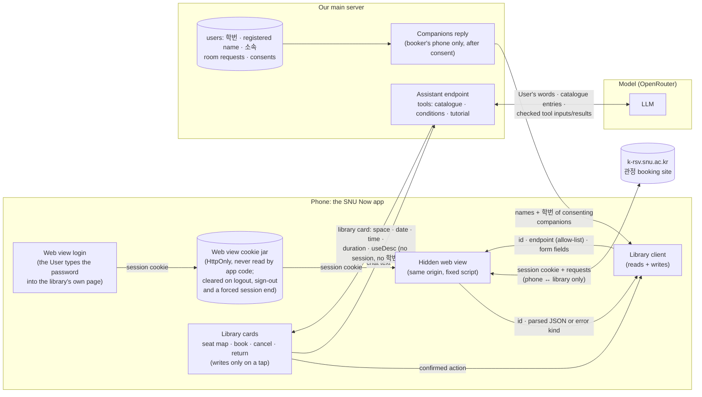

# P06: The freshman tutorial (새내기 튜토리얼) and 관정도서관 booking in the Assistant

Status: ready-for-agent

References: `references/kwanjeong-site.md` holds what the booking site does (endpoints, payloads, statuses, seat maps), read-only, on 2026-11-01. `references/kwanjeong-spaces.yaml` is the space catalogue, with each space's purpose and aliases. This spec writes down the owner's decisions from the grillings on 2026-10-31 and 2026-11-01. Where they differ from the wireframe frames, the decisions win. The pager in particular post-dates the frames. The Assistant is described in `.scratch/iteration-2/P07-ai-activity-chat/spec.md`, ADR 0005 and ADR 0009. The eval harness is described in `.scratch/iteration-2/P19-ai-metric/spec.md`, with the P4 and P5 suites beside it.

## Problem Statement

A new student does not know where the basics of campus life are. Where do you get the student card? Which shuttle goes up from 행정관? How do you book a seat in the library, and what happens if you forget to return it? Where is the health clinic, and what is on at the museum? SNU Now shows the map, the menus and the parties, but it does not walk a freshman or an exchange student through any of this.

관정도서관 is the place students use most. Booking it means the official app, the web site or a kiosk. A seat must be confirmed at a kiosk within 30 minutes, and unreturned seats lead to a ban. A group study room needs every member's name and 학번. The Assistant cannot help today. Its prompt says study spaces are not supported (`chat-assistant.ts`), and P19's case `out-of-scope-library-seats` expects a refusal.

## Solution

Two capabilities. Both rest on content and rules the server owns, and the model only reads the request and words the reply.

- **새내기 튜토리얼.** Some Users get a small "새내기 튜토리얼 시작하기" button at the bottom of the main screen: those whose admission year is this year or later, and those who turned it on in 내 정보. It opens a pager, "새내기 튜토리얼 n/N", with ◀ ▶.
  - Each page is one quest: 학생증(S-CARD) 발급받기, 행정관 셔틀 이용하기, 관정도서관 예약하기, 서울대 보건진료소 이용, 서울대 미술관/파워플랜트 관람.
  - 퀘스트 시작 puts that quest on top of the quest list. Several can run at once, and a User skips what does not interest them.
  - A quest's sheet shows its text, places and links. 완료했어요 completes it, with a fixed message.
  - The 관정 quest checks the User's library bookings on the phone. When none is found, the User chooses 다시 확인, 그냥 완료하기 or 어시스턴트에게 예약 부탁하기.
  - The tutorial ends when all quests are done, or with 튜토리얼 그만하기. 내 정보 turns it on again.
  - Progress is kept on the server. The text lives in a YAML file in the repository, and the Assistant answers questions about the quests from that file.
- **관정도서관 booking in the chat.** "7층 열람실 5시부터 두 시간 잡아줘", "내일 3시에 4층 스터디룸 민수랑 지은이랑", "지금 8층 자리 있어?", "반납해줘".
  - The Assistant finds the space in the catalogue and checks the booking window and the hours. It answers with a card. The phone, which alone holds the User's library session, fills the card with live seats or rooms and books, cancels or returns only after the User presses the card's button.
  - Seats show on the site's own seat map, small in the chat and large on a tap. Tapping a free seat gives a booking card for it.
  - A group study room is booked by a 파티. Each invited Friend consents to share their 학번, and a refusal dissolves a 파티 made for the booking. A 파티 holds at most 8 people, so a booking for 9 or more is refused and G201 (20인실, 11 or more) is not offered.
  - Spaces that cannot be booked online get a "현장 이용" answer. Spaces outside the scope get "아직 미구현".

Words:
- a **space** is one entry of the catalogue: a reading-room sector, a group-study-room size on a floor, or a media room;
- the **library session** is the booking site's `JSESSIONID` cookie, kept on the phone only, in the web view's own cookie jar;
- a **library card** is a card of a reply that the phone fills from the library;
- a **booking party** is a Closed Quest (비공개 파티) made for a group-study-room booking;
- a **room request** is the server's record of the consents for one group-study-room booking;
- a **tutorial quest** is one page of the tutorial. It is not a Quest row (Implementation Decisions).

## User Stories

### The tutorial

1. As a 26학번 User, I want a small "새내기 튜토리얼 시작하기" button at the bottom of the main screen, so that I find the tutorial without looking for it.
2. As an exchange student (소속 교환학생 in 내 정보), I want the same button, so that the tutorial meant for me reaches me.
3. As any other User, I want a "새내기 튜토리얼" row in 내 정보 with 진행하기, which turns the button on, so that I can take the tutorial too.
4. As a User who finished the tutorial, stopped it or never turned it on, I want nothing about it on the main screen, so that it does not take room.
5. As a User, I want the button to open a pager, "새내기 튜토리얼 n/N", with ◀ ▶ to browse the quests and 퀘스트 시작 on each, so that I start only what interests me.
6. As a User, I want several quests running at once, each on top of the quest list under "새내기 튜토리얼", so that I do them in any order.
7. As a User, I want to open a started quest and read what to do, where (with the place on the map) and the links, so that I can do it.
8. As a User, I want 완료했어요 to complete a quest and show its fixed completion message, so that I know it counted.
9. As a User doing the 관정 quest, I want 완료했어요 to check my library bookings, show the booking it found with "확인됨", and say "관정도서관 이용은 어떠셨나요? 도서관을 자주 이용해 보아요!", so that it really checks.
10. As a User whose check found nothing, I want 다시 확인, 그냥 완료하기 and 어시스턴트에게 예약 부탁하기, so that I am never stuck.
11. As a User who has used 관정 before, I want "이미 예약 및 이용해본 적이 있어요" to complete the quest at once, so that I am not made to book again.
12. As a User, I want the pager to show the next quest not started after I complete one, and "튜토리얼을 모두 마쳤어요" after the last, so that I can carry on.
13. As a User, I want "튜토리얼 그만하기" to end the tutorial, and 진행하기 in 내 정보 to bring it back with my progress kept, so that I can stop without losing anything.
14. As a User, I want my progress kept on the server, so that it follows me to another phone.
15. As a User, I want to ask the Assistant about a tutorial quest ("학생증 어디서 받아?") and get an answer drawn from the tutorial's text only, so that it never invents hours or places.

### Library session

16. As a User, I want to log in to the library once in a web view inside the app, with the school's own login page, so that SNU Now never sees my password.
17. As a User, I want the session kept on my phone only, so that our server, its logs and the AI never hold it.
18. As a User, I want to be asked to log in again only when the school's session has ended, so that I am not asked every time.
19. As a User, I want to log out of the library from 내 정보, and signing out of SNU Now to log me out of the library too, so that the session is really gone and the next person on this phone never sees my bookings.

### Booking in the chat

20. As a User, I want to name a space my way ("7층 열람실", "노트북존", "6층 영화 보는 곳", "모니터 있는 스터디룸"), so that I need not know the site's names.
21. As a User, I want the Assistant to ask which one when my words fit several spaces, so that it never picks for me.
22. As a User, I want it to ask for the time when I gave none ("몇 시부터 몇 시까지 예약할까요?"), so that nothing is booked at a guessed time.
23. As a User, I want a booking card with the space, the seat or room, the date and the time, and 예약하기 and 취소, so that nothing is booked until I press 예약하기.
24. As a User, I want "내 공강에 열람실 잡아줘" to use my Free Time, so that the seat fits my day.
25. As a User, I want a request outside the booking window refused with the reason (seats today only, rooms up to 3 days ahead, the hours, the longest time), so that I know why.
26. As a User, I want a space that cannot be booked online (G202, 멀티미디어 감상석, 정보검색실, the carrels) answered with "현장에서 이용", so that I know where to go.
27. As a User, I want a space outside the app's scope (본관, other floors, other libraries) answered with "아직 미구현", so that I am not misled.
28. As a graduate student (소속 대학원 in 내 정보), I want 대학원 열람실 offered. As anyone else, I want it not offered, so that the Assistant does not propose what the library will refuse.
29. As a User, I want "지금 7층 자리 있어?" to show the site's seat map with the free seats lit, small in the chat and large on a tap. Tapping a free seat should give a booking card for it.
30. As a User, I want a group study room's purpose (사용용도) inferred from what I said ("팀플" → 과제), and a picker in the card when it cannot be, so that the booking has what the library requires.
31. As a User booking a media room, I want the card to show the 서약서 with a checkbox that 예약하기 waits for, so that I agree as the site requires.
32. As a User, I want the done message to give the booking and say "사용 다했으면 꼭 반납처리를 해주세요! 저한테 말해주셔도 되고 키오스크를 이용해 반납하셔도 돼요!", and for a seat, that it must be confirmed at the kiosk within 30 minutes, so that I am not banned.
33. As a User, I want "반납해줘" to give a return card for the seat I am using, and "예약 취소해줘" a cancel card, each confirmed by a button, so that I can do it from the chat.
34. As a User, I want "내 예약 보여줘" to list my bookings, so that I can see them without the library's app.
35. As a User, I want a failure to say what happened (the library's own message, the session ended, the seat was just taken), so that I know what to do.

### Group study rooms

36. As a User, I want "내일 3시 4층 스터디룸 민수, 지은이랑" to check that three people fit the room (GR_MIN–GR_MAX) and a 파티 (at most 8), so that I do not try a room the library or SNU Now refuses.
37. As a User, I want a booking party made and my Friends invited, so that the booking is a 파티 we share.
38. As an invited Friend, I want to be asked "(내 이름)님의 학번이 필요해요. 제공해도 될까요?" with the registered name and 학번 that will be sent, so that I decide each time.
39. As a member, I want everyone to see "파티 구성원이 제안을 거절했습니다" and the booking party dissolved when anyone declines, so that nobody waits for a booking that will not happen.
40. As a User, I want an existing 파티, such as a lunch 파티, never dissolved by a declined booking, so that a booking cannot break it.
41. As a User, I want my companions' registered names and 학번 taken from their 내 정보, and the member whose details the library rejects asked to check them, so that a typo is fixed without starting over.
42. As a member, I want my 학번 to reach only the booker's phone, only for that booking, and never the AI, so that sharing it is safe.

### The team

43. As the P6 owner, I want a frozen eval suite (`main-server/eval/p6/`) with labels drafted blind and reviewed by a person, run 3 times, with thresholds committed before any result, so that the Assistant's library and tutorial behaviour is measured honestly.
44. As a team member, I want CI tests that need no model and no real library, against a fake library built from the recorded responses, so that CI stays deterministic and never books.
45. As a team member, I want the fixed P19 set run before and after, with no case newly failing, so that the chat does not get worse (ADR 0009).

## Implementation Decisions

### Profile: 학번, registered name and 소속

- `User` gains:
  - `studentNumber String?`: 학번. Stored without hyphens. It must match `^\d{4}-?\d{5}$` when given, and is saved as nine digits.
  - `registeredName String?`: 학적상 이름, the name the library knows. Left empty, it is taken to be `name`.
  - `affiliation` (`undergraduate | graduate | exchange`, nullable): 소속 학부/대학원/교환학생.
- The 내 정보 edit screen (`profile-edit-screen.tsx`) gains the three fields. Onboarding does not change.
- **Who sees them.**
  - `studentNumber` and `registeredName` appear only in the User's own profile reply and in the companions reply of a room request (below).
  - They never appear in a Friend list, a Quest, a Party, a search, an Assistant tool's result, a log line or an eval file.
  - `affiliation` is the User's own. The Assistant's tools read it on the server and never return it.
- The privacy text (`legal-documents.ts`) names the new items and their one use: a group-study-room booking, with consent each time. It also states that the library session stays on the phone.

### The tutorial

**Shape.**
- A tutorial quest is not a Quest row. It has no Holder, Board, Sub Quest or capacity. If it were a Quest, it would show on Boards and in Free Time (`UserDayService` reads held Sub Quests).
- The app shows the started ones in the quest list as their own group. GLOSSARY gains **Tutorial** (새내기 튜토리얼) and **Tutorial Quest**, each with _Avoid: Quest_ for the other.

**Content: `main-server/content/tutorial.yaml`.**
- The file is loaded and checked with zod when the server starts. The server fails to start on a bad file.
- Each quest has:
  - `key`, `order`, `title`, `brief` (the pager's line), `body` (the sheet's text, with paragraphs), `condition` (완료 조건);
  - `completion`: `{ kind: button }`, or `{ kind: kwanjeongCheck, skipLabel }`;
  - `completionMessage`: fixed text;
  - `places`: each `{ place: <Place number>, floor? }` from the shared seed, or `{ point: { latitude, longitude }, label }`;
  - `links`: each `{ label, url }`.
- The content (Korean, final wording to be reviewed by the owner where marked *drafted*):

| order | key | title | places / links | completion |
|---|---|---|---|---|
| 1 | `s-card` | 학생증(S-CARD) 발급받기 | Place 67 (NH농협두레문예관), floor 2; Place 4 (우리은행); MySNU `https://my.snu.ac.kr`; 학생처 S-CARD 발급 절차 (student.snu.ac.kr › 대학생활 › 기타 › s-card › 발급 절차) | button |
| 2 | `admin-shuttle` | 행정관 셔틀 이용하기 | point 37.460938, 126.950312, "행정관 셔틀 정류장 (행정관 잔디광장 아래)" (plus code 8Q98FX62+94) | button |
| 3 | `kwanjeong` | 관정도서관 예약하기 | Place 62-1 (중앙도서관 관정관) | kwanjeongCheck, skip "이미 예약 및 이용해본 적이 있어요" |
| 4 | `health-clinic` | 서울대 보건진료소 이용 | Place 63 (학생회관), floor 2; `https://health4u.snu.ac.kr/index.do` | button |
| 5 | `art-museum` | 서울대 미술관/파워플랜트 관람 | Place 151 (미술관), Place 68 (파워플랜트); `http://www.snumoa.org/`, `https://culture.snu.ac.kr/event/powerplant365/` | button |

- Texts:
  - **s-card**
    - brief: "학생증(S-CARD)을 신청하고 받아 보세요." *(drafted)*
    - body:
      - "학생증(S-CARD)은 도서관 출입처럼 학교생활 곳곳에서 써요."
      - "· 신청: MySNU에서 온라인으로 신청해요."
      - "· 수령: 신청한 다음 날부터 학생지원센터(67동 NH농협두레문예관 2층)에서 받아요. 평일 9:00–17:50에 열어요."
      - "· 금융 기능이 있는 학생증은 우리은행(4동)에서 처리해요. 교환학생은 금융 학생증을 받을 수 없어요."
      - "· 모바일 학생증은 '서울대학교' 앱에서 쓸 수 있어요."
    - condition: "학생증 받기" *(drafted)*
    - completionMessage: "학생증을 받았군요! 이제 도서관과 학교 시설을 마음껏 이용해 보세요." *(drafted)*
  - **admin-shuttle**
    - brief: "행정관 앞에서 셔틀을 타 보세요." *(drafted)*
    - body:
      - "행정관 셔틀은 행정관 잔디광장 아래 정류장에서 타요. 카카오맵에서 '메가커피'를 검색하면 정류장을 찾기 쉬워요."
      - "셔틀 대신 5511, 5513, 5516번 버스를 타도 돼요."
    - condition: "행정관 셔틀 타 보기" *(drafted)*
    - completionMessage: "셔틀 타 보니 어떠셨나요? 캠퍼스 이동이 한결 편해질 거예요!" *(drafted)*
  - **kwanjeong**
    - brief: "관정도서관 열람실을 예약하고 이용해 보세요." (wireframe)
    - body:
      - "관정도서관은 관정도서관 내부 키오스크에 로그인한 후 좌석을 예약하거나, 관정도서관 공식 앱, 또는 이 SNU Now에서 어시스턴트에게 부탁해 예약을 진행할 수 있어요. 이번 튜토리얼에서는 관정도서관을 이용해보세요!" (wireframe, with "오프라인으로," dropped)
      - "열람실 좌석은 예약한 뒤 30분 안에 좌석배정기(키오스크)에서 확인해야 해요. 확인하지 않으면 자동으로 반납돼요."
      - "확인하지 않거나 반납하지 않은 일이 한 달에 5번이면 10일 동안 예약할 수 없어요. 그룹스터디룸은 1시간 안에 들어가지 않으면 취소되고, 7일에 3번이면 3일 동안 예약할 수 없어요."
      - "사용 다했으면 꼭 반납처리를 해주세요! 저한테 말해주셔도 되고 키오스크를 이용해 반납하셔도 돼요!"
    - condition: "관정도서관 열람실이나 스터디룸 예약 및 이용"
    - completionMessage: "관정도서관 이용은 어떠셨나요? 도서관을 자주 이용해 보아요!"
  - **health-clinic**
    - brief: "보건진료소가 어디 있는지 알아 두세요." *(drafted)*
    - body:
      - "서울대 보건진료소는 학생회관(63동) 2층에 있어요. 진료 시간과 이용 방법은 보건진료소 홈페이지에서 확인할 수 있어요."
    - condition: "보건진료소 위치와 이용 방법 확인하기" *(drafted)*
    - completionMessage: "아플 땐 참지 말고 보건진료소를 찾아 주세요!" *(drafted)*
  - **art-museum**
    - brief: "캠퍼스 안의 미술관과 파워플랜트에서 전시를 봐요." *(drafted)*
    - body:
      - "서울대학교 미술관(151동)과 파워플랜트(68동)에서 전시를 볼 수 있어요. 지금 하는 전시는 각 홈페이지에서 확인해 보세요."
    - condition: "미술관이나 파워플랜트 전시 관람하기" *(drafted)*
    - completionMessage: "전시는 즐거우셨나요? 캠퍼스 곳곳의 문화 공간을 자주 찾아 보세요!" *(drafted)*
- Adding a quest later is a YAML entry. `N` is the number of entries.

**Progress: server-side.**
- Two tables:
  - `TutorialProgress { userId PK, enabledAt?, stoppedAt?, finishedAt?, rowHiddenAt? }`;
  - `TutorialQuestProgress { userId, questKey, startedAt, completedAt?, completedBy? (button | checked | forced | skipped), @@id([userId, questKey]) }`.
  - Unknown keys (a quest removed from the YAML) are ignored on read.
- **Eligible by default:** `admissionYear ≥` the current year in Korea (by the server's clock), or `affiliation = exchange`.
- **What the timestamps mean.** Each is set or cleared only by the rules below, so the state never compares timestamps or reads a missing one as a time:
  - `enabledAt`: the tutorial is on. `POST /tutorial/enable` sets it. For a User eligible by default, `GET /tutorial` sets it the first time it finds no `enabledAt` and no `stoppedAt` (creating the row), so "eligible by default" is stored once and later changes to the admission year or 소속 do not turn it off.
  - `stoppedAt`: the User stopped it. `POST /tutorial/stop` sets it; `enable` clears it (and sets `enabledAt` again).
  - `finishedAt`: set when a complete makes every quest of the content **at that time** completed. It is never cleared by adding quests: quests added to the YAML later do not reappear for a finished User. Only `enable` from 내 정보 clears it, and then the new quests show as not started.
- **The state, derived** in this order, the first that holds:
  - `finished`: `finishedAt` is set;
  - `stopped`: `stoppedAt` is set;
  - `off`: `enabledAt` is not set (no row, or a row with only `rowHiddenAt`);
  - `active`: at least one quest of the content is started (completed or not);
  - `available`: otherwise (on, nothing started).
  - The main screen shows the button in `available` and `active` while some quest is not started. It shows the quest-list group in `active`. Elsewhere it shows nothing.
- **Endpoints**, all as the signed-in User:
  - `GET /tutorial` → `{ state, quests: [{ ...content, status: notStarted | started | completed }] }`. The content is served from the YAML, so the app has no copy.
  - `POST /tutorial/enable` (진행하기): sets `enabledAt` and clears `stoppedAt` and `finishedAt`. Progress is kept.
  - `POST /tutorial/stop` (튜토리얼 그만하기, and 끄기 in 내 정보).
  - `POST /tutorial/hide-row` (the ✕ of the 내 정보 row while `off`).
  - `POST /tutorial/quests/:key/start`.
  - `POST /tutorial/quests/:key/complete { by }`: `button` is accepted only for a button quest, and `checked | forced | skipped` only for `kwanjeongCheck`. The phone does the 관정 check, so the server records how the quest was completed and does not verify it. A complete that leaves no quest of the content uncompleted sets `finishedAt` (above).
  - Each call is idempotent and answers with the new `GET /tutorial` body.

**App.**
- **Main screen.** The start button is "새내기 튜토리얼 시작하기", with a flag icon, bottom-left above the footprints row, as in MainTutorialStart. It is hidden while a card, the chat or the replay is open.
- **The pager** replaces the frames' "첫 퀘스트" popup:
  - a dialog with the kicker "새내기 튜토리얼 n/N", the quest's title and brief, and ◀ ▶ (disabled at the ends);
  - a status chip: 진행 중 for a started quest, 완료 for a completed one;
  - the primary button "퀘스트 시작" (for a started quest, "내용 보기", which opens its sheet), "튜토리얼 그만하기" as a text button, and 닫기.
  - It opens on the first quest not started.
- **The quest list.** Started quests sit on top, in the group "새내기 튜토리얼" (MainTutorialList): kicker "새내기 튜토리얼 · n/N", the title, and "완료 조건 · {condition}". Tapping one opens its sheet.
- **The quest sheet** (MainTutorialSheet):
  - "새내기 튜토리얼 · n/N", the dots, the title, the body, and the 완료 조건 box;
  - one "지도에서 보기" per place, which focuses the main map on the Place or point, and each link (opened with `expo-web-browser`);
  - the buttons:
    - button quests: 나중에 and 완료했어요;
    - the 관정 quest: 나중에, 완료했어요, 어시스턴트에게 예약 부탁하기 (full width), and the skip text button "이미 예약 및 이용해본 적이 있어요".
- **Completing.**
  - A button quest shows its completionMessage in the sheet's Assistant bubble (MainTutorialOk without the booking row), then 퀘스트 완료. That calls complete and opens the pager on the next quest not started ("퀘스트 완료! 다음 퀘스트 · n/N", MainTutorialNext). After the last quest it shows "새내기 튜토리얼 완료 / 튜토리얼을 모두 마쳤어요 / 이제 SNU Now를 자유롭게 써 보세요. / 닫기".
  - **The 관정 check:**
    1. The sheet shows "관정도서관 예약 내역을 확인하고 있어요 ···". Without a library session, the login web view opens first, and cancelling it counts as not found.
    2. The phone calls `getMyBookingList(start = today − 30 days, end = today + 3 days)`.
    3. Found means a row with STATUS 2 (booked), 3 (checked in), 4 (좌석미반납, 사용시간 만료: the use time ran out without a return, so the seat was used) or 5 (returned, 본인반납).
    4. On found (MainTutorialOk): the most recent row as "{ROOM_NAME} · {SEAT_VNAME}번" / "{M월 D일} {USESTART}–{USEEXPIRE} · 예약·이용 기록" with "확인됨", the completionMessage, and 퀘스트 완료 (complete `checked`).
    5. On not found (MainTutorialFail): "아직 관정도서관 예약 기록이 없어요.\n예약하고 이용한 뒤 다시 확인해 주세요." with 다시 확인, 그냥 완료하기 (complete `forced`) and 어시스턴트에게 예약 부탁하기.
    6. A failed call (network, or the session ending mid-call) shows "도서관 서버에 연결하지 못했어요. 잠시 후 다시 확인해 주세요." with the same buttons.
  - The skip completes `skipped` and shows the completionMessage.
  - 어시스턴트에게 예약 부탁하기 closes the sheet, opens the chat and sends "관정도서관 7층 열람실에 한 자리 예약해줘" (the frames' text).
- **The 내 정보 row** (ProfileTutorial). The subtitle by state:
  - `off`: "학교생활이 처음이라면\n퀘스트로 하나씩 익혀 보세요" with 진행하기 and ✕;
  - `available`, eligible by default (by the rule, read now): "지도 화면 아래 버튼으로 시작할 수 있어요";
  - `available`, enabled: "켜 두었어요 · 지도 화면 아래 버튼으로 시작해요" with 끄기;
  - `active`: "진행 중 · 완료 k/N · 지도의 퀘스트 목록에서 이어서 해요" with 그만하기;
  - `stopped`: "그만두었어요 · 다시 하려면 진행하기를 눌러요" with 진행하기;
  - `finished`: "모두 완료했어요". When the content has quests the User has not completed (added after `finishedAt`), it adds "새 퀘스트가 있어요" with 진행하기.

### The library session (device only)

- **Native modules.**
  - Two modules are added, neither yet in `mobile/package.json`: `react-native-webview`, and `@react-native-cookies/cookies`, used **only to clear** the web view's cookies at logout (`clearAll(true)`, plus `flush()` on Android). App code never reads a cookie: `get` and `getAll` (and any other read of the module) are forbidden by lint rules: `no-restricted-properties` on the module's `get`, `getAll` and `getFromResponse`, and `no-restricted-imports` of the module everywhere but the one logout file in `mobile/src/library/`. SecureStore holds nothing of the session.
  - `expo-secure-store` and `expo-web-browser` are already there.
  - **This is a native change.** It raises `version` in `app.json`, which makes a new fingerprint, and needs a native Release by P03's flow (`infra/production/README.md` § The Production APK, and `app-version.json`). Installed 1.0.0 APKs get none of P6's library screens until they update. The tutorial (except the 관정 check) and the server tools need no native change, and the 1.0.0 JS bundle never receives library cards (see Cards).
  - **One native Release with P03 ticket 05.** The change ships in the same Release as P03 ticket 05's planned 1.0.1 verification release: `version` goes from 1.0.0 to 1.0.1, the CI builds the APK from the tag, and the fingerprint's comment stripping from #128 may ride along. The Mac owner builds iOS.
- **Where the session lives.** The session is the `HttpOnly` cookie `JSESSIONID` on `k-rsv.snu.ac.kr` (path `/NEW_SNU_BOOKING/`). It lives only in the web view's own cookie jar. App code never reads, copies or stores it: not in SecureStore, not in JS memory, not in a log. The cookie module only clears the jar (Logout).
  - Both web views (the login and the hidden one) use the default, persistent web view store (not `incognito`), so they share that jar.
  - The app keeps only a "logged in" flag (`kwanjeong.loggedIn` in AsyncStorage). It holds nothing from the site, is set after a login and is cleared when the session ends or on logout.
- **Login.**
  1. A full-screen, visible web view loads `https://k-rsv.snu.ac.kr/NEW_SNU_BOOKING/pc/main`, which sends the User to the school's login.
  2. When the URL is back on `k-rsv.snu.ac.kr` at `/pc/(main|booking|mybooking)`, the login is done. The `JSESSIONID` stays in the web view's cookie jar, the app sets the flag, and the view closes.
  3. No script is injected into the login pages, so the app never reads the password. The login has a 5-minute limit, after which the view closes with "로그인하지 못했어요". Cancelling returns "no session" to the caller.
- **Calls (the hidden web view).** Every library call, reads and writes, runs inside one hidden web view, made by one client module (`mobile/src/library/`):
  - The hidden view has no size, is kept mounted at the app's root while the flag is set, and loads `https://k-rsv.snu.ac.kr/NEW_SNU_BOOKING/pc/main`, so its scripts run on the library's origin. The client waits for that page before the first call.
  - For each call the app injects (`injectJavaScript`) one small fixed script, a constant in `mobile/src/library/`. Only its argument varies, a value made with `JSON.stringify`; no script text is built from the User's words or a reply.
  - The script makes the form POST with `fetch('/NEW_SNU_BOOKING/json/<name>')`: form-encoded, `credentials: 'same-origin'`, `redirect: 'manual'`, the headers `X-Requested-With: XMLHttpRequest` and `OS_KIND: WEB`, and `referrer` set to `…/pc/booking/roomForm`. The browser adds the cookie, `Origin` and the web view's own user agent.
  - It posts back through `window.ReactNativeWebView.postMessage` only the parsed JSON or an error kind, never the raw text, headers or cookie.
- **The message protocol.**
  - App → view: `{ id, endpoint, body }`. `id` is a fresh request id. `endpoint` is a name on the allow-list. `body` is a flat object of form fields.
  - View → app: `{ id, ok: true, result }` with the parsed JSON (for the room form, only the four values below), or `{ id, ok: false, error }` with `error` one of `sessionEnded`, `network` or `notAllowed`.
  - The app matches `id` to its pending call. It ignores a message with an unknown `id` or from a page not on `k-rsv.snu.ac.kr`.
  - Timeouts: 20 seconds for the hidden view's page load and 15 seconds per call. A timeout counts as `network`. A write that times out is never retried by itself; the card reloads 내 예약 to show what happened.
- **The allow-list.** The script and the client each hold the same list and refuse anything else with `notAllowed`:
  - reads: `getSectorList`, `getRoomList`, `getSeatBookingList`, `getSeatInfoFromList` (GR_MIN, GR_MAX), `getUserCheck`, `getMyBookingList`;
  - the room form page, `GET /pc/booking/roomForm`, which the script parses in the page and from which it posts back only the applicant's own name and 학번 (`tmpUserNames` and `tmpSchoolNos`) and the prefilled phone number and email (`.phoneNum` and `.eMail`), which `setRoomBooking` requires. These stay on the phone;
  - writes: `setRoomBooking`, and `setCancelBooking` for a cancel (STATUS 1 or 2) and for a return (STATUS 3). The client accepts a write only from a card's confirmed action, the card's confirm button.
  - `setSeatReturn` is not on the list, since no site button uses it.
- **Session ended.** HTTP 999, a redirect, or a reply that is not JSON gives `sessionEnded`, and so does the hidden view's page landing anywhere off `k-rsv.snu.ac.kr`/`/pc/`. The client clears the flag and the card shows "관정도서관 로그인이 끝났어요. 다시 로그인해 주세요." with 로그인, which opens the login again. After the login, the action the User pressed is retried once.
- **Seat-map images** load from `https://k-rsv.snu.ac.kr:444/MAP/WEB/area_<sectorNo>.png?version=20261022` with no cookie, as plain images outside the web view. The size per sector is in the catalogue.
- **Logout** really ends the library session. One shared step in `mobile/src/library/`, "end the library session", does it, and three paths call it:
  - the 내 정보 row "관정도서관 로그인", which shows 로그아웃 while the flag is set;
  - the app's `signOut()` (`mobile/src/auth/sign-in.ts`), before it forgets the main server's tokens, whether or not the flag is set;
  - the forced end of the app's session, `endSession()` (`mobile/src/session/session-events.ts`), which forgets the tokens and shows the sign-in screen without going through `signOut()` (a refused token, or the session replaced on another phone), before it forgets the tokens, whether or not the flag is set.
- Ending the session is, in order:
  1. when the `kwanjeong.loggedIn` flag is set, the hidden view loads the site's logout URL (with the same 15-second limit; a failure does not stop the next steps). When the flag is absent, this step is skipped: no hidden view, no network call and no wait;
  2. every web-view cookie is cleared with `@react-native-cookies/cookies` `clearAll(true)`, then `flush()` on Android. On iOS, `clearAll()` without `true` clears only `NSHTTPCookieStorage`, while the web view's cookies are in `WKWebsiteDataStore`, which only `clearAll(true)` (`useWebKit`) clears; Android ignores the argument;
  3. the `kwanjeong.loggedIn` flag is cleared.
  - A read after logout gives `sessionEnded`, and the next login asks for the password again. After a sign-out, or a forced end of the app's session, and a sign-in with another account, none of the previous person's bookings can be read. This holds on Android and on iOS.
- **Never sent to our servers:** the session, any library reply, the applicant's or companions' library data, phone, email, BSEQNO. The app's error reporting and logs drop library request and response bodies.

### The space catalogue

- `references/kwanjeong-spaces.yaml` becomes `main-server/src/assistant/library/kwanjeong-spaces.yaml`. The server loads and checks it with zod at start.
- Each space has an `id`, floor, `roomNo`, `sectorNo`, `seatNos` (with the equipment groups of 14103 and the named media rooms), name, kind, purpose, aliases with their source, capacity, hours, duration, `useDesc` options, `needs_pledge` with its text, `bookable`, `why_not`, `implemented` and, for 18301, the graduate eligibility.
- Three new fields:
  - `mapImage`: `{ width, height }` for seat sectors;
  - `booking_ahead_days`: 0 for seats, 3 for rooms;
  - `step_minutes`: 30.
- G201 (`2F-group-20`) keeps `implemented: true` (the site books it) and carries `party_note: "needs ≥ 11 people, not bookable through a party yet"`. `proposeLibraryBooking` refuses it with the 8-people message (Assistant, "At most 8 people").
- **Result kinds** of a space:
  - `implemented`: bookable online and in scope;
  - `notOnline`: `bookable: false` inside 관정관 (G202, 161 멀티미디어, 163 정보검색실, the carrels 174 and 184);
  - `unsupported`: `implemented: false` and not `notOnline` (본관, 관정관 1/3/5층, anything not in the catalogue);
  - `notEligible`: 대학원 열람실 for a User whose `affiliation` is not `graduate`.

### Assistant: the library and tutorial tools (ADR 0009)

- **Shape.** The tools live in `main-server/src/assistant/library/` and `src/assistant/tutorial/`. Their rules are fragments of their own, `LIBRARY_RULES` and `TUTORIAL_RULES`, appended to the chat's prompt after `FREE_TIME_RULES`. There is no new Feature. The chat's tool list only names the tools.
- The chat prompt's last rule ("Study spaces, such as library seats and 열람실, are not supported yet. Say so when asked.") is removed. It is the one change to the chat's own rules.
- **The model passes ids and the User's words, and the server decides,** as in P07.
  - The model sees: the catalogue summary (id, floor, name, purpose and aliases, generated from the YAML into the `findLibrarySpace` description); its own tools' results; and Friends' names and ids from `resolveFriend`.
  - It never sees seats, room availability, the User's bookings, BSEQNO, 학번, registered names, phone, email or the session.
- **Tools.**
  - **`findLibrarySpace({ spaceIds?, words })`** is the resolver.
    - The model passes the catalogue ids it read the request as (one or more), or none, with the User's words as written.
    - It answers per id with `implemented | notOnline | unsupported | notEligible`. Each answer carries:
      - name, floor, kind, capacity, hours, durations, the window, `useDesc` options and `needs_pledge`;
      - for `notOnline`, the reason (현장 이용) and the site note;
      - for `unsupported`, "아직 미구현";
      - for `notEligible`, that it is for graduate students.
    - With no id, it answers `unsupported`.
    - With two or more `implemented` ids it answers `several`, and the rules say to ask, listing the names. When P07's choices merge, these become chips of a new `ChoiceKind` `librarySpace`.
    - It records the ids it returned in `FoundIds` (new `FoundKind` `librarySpace`).
  - **`findLibraryFreeSlots({ spaceId, date, minutes? })`** returns the User's Free Time that day:
    - computed with `freeTimeOf(await days.itemsOn(userId, date), date, now)` (P04, merged on `3.0/Main` in #142);
    - clipped to the space's hours and the booking window, and aligned to 30 minutes;
    - only the stretches at least `minutes` (default 30) long, each cut to the space's longest duration;
    - each with the names of the items around it, never their Places.
    - It reaches P04 through a `FreeTimePort` interface, so that the P6 eval world can bind its own day.
  - **`proposeLibraryBooking({ spaceId, date, start, minutes | end, seat?, equipment?, useDesc?, friendIds?, questId? })`**
    - It refuses, listing every field at once:
      - a missing `start` or duration;
      - a date outside the window (seats: today only; rooms: today to today + 3 days, by Korea date at the server's clock);
      - a start already past (rounded up to the next 30 minutes);
      - a time outside the hours (seats 07:00–23:00; rooms by the catalogue);
      - a duration not a multiple of 30 or outside the space's range;
      - a `seat` that is not a label of the sector;
      - a `useDesc` not among the space's options;
      - people outside the room's capacity (below).
    - Each refusal comes with the reason and the bound, worded for the reply (for example "열람실은 당일만 예약할 수 있어요", "그룹스터디룸은 3일 뒤까지만 예약할 수 있어요", "열람실은 최대 6시간이에요").
    - **People** are the User plus `friendIds` (ids `resolveFriend` returned in this message) or the Holders of `questId` (a Quest the User holds). They are compared with the space's capacity as numbers. Below GR_MIN, the refusal gives how many more are needed. Above GR_MAX, it names the larger sizes on that floor that fit and a party can hold (GR_MIN ≤ 8).
    - **At most 8 people.** A booking party is a Quest, and a Quest's capacity is 1–8 (`quests_capacity_check`, `quest-requests.dto.ts`), which stays. So people above 8 (the User plus 8 or more Friends) are refused with "파티는 최대 8명까지라 9명 이상 방 예약은 아직 못 해요 — 직접 예약해 주세요", whatever the room. A space whose GR_MIN is above 8 (G201 20인실, GR_MIN 11) gets the same refusal for any number of people, and is never named as a larger size. 10인실 rooms (GR_MIN 7) stay bookable by 7 or 8 people.
    - Reading rooms take no companions. With companions, it refuses and says seats are individual.
    - Media rooms take companions through the same booking party as group rooms.
    - It refuses a `notOnline`, `unsupported` or `notEligible` space with that answer's reason.
    - Otherwise it shows a **book** card and answers `{ result: 'shown', summary }`, the summary in words, with no live data.
  - **`proposeLibraryCancel({ date?, spaceId?, start? })`** shows a **cancel** card for bookings with STATUS 1 or 2 that match.
  - **`proposeLibraryReturn({ spaceId? })`** shows a **return** card for the booking in use (STATUS 3).
  - **`showLibrarySeats({ spaceId, date?, start?, minutes? })`** shows a **seats** card: a seat sector's map, or a room sector's free rooms and slots.
  - **`showMyLibraryBookings({ from?, to? })`** shows a **myBookings** card.
  - **`getTutorial({ questKey? })`** returns the tutorial's content from the YAML, all quests or one, and the User's status for each (`notStarted | started | completed`, and the tutorial's state). Its text is the repository's own and is not wrapped as others' text.
- **`LIBRARY_RULES`**, stated by meaning, with no keyword list:
  - which tool answers:
    - a request to book: `findLibrarySpace`, then `proposeLibraryBooking`;
    - "자리 있어?" or "좌석 현황": `showLibrarySeats`;
    - "공강에" or "수업 사이에": `findLibraryFreeSlots` first;
    - cancel, return or "내 예약": the three tools.
  - to pass every catalogue id that fits the words, and never pick when several fit: ask, listing them;
  - to ask for the time when none was given, in one question with any other missing field;
  - to read 오늘, 내일, 모레 and weekdays against now; "N시간" as minutes; "~까지" as `end`; and "지금" as the next 30 minutes;
  - to infer `useDesc` only when the request states the purpose (팀플, 과제 → 과제; 동아리 → 동아리활동; 촬영, 영상 → 콘텐츠제작 where offered), and otherwise leave it out so that the card asks;
  - to resolve Friends with `resolveFriend` first, as for a Proposal;
  - for `notOnline`, to say it is used on site (현장 이용) and never substitute another space, such as a studio for 감상석;
  - for `unsupported`, to say "아직 미구현이에요" and what is supported;
  - for `notEligible`, to say 대학원 열람실 is for graduate students, as set in 내 정보;
  - for a refusal, to give its reason and ask for the changed value;
  - for a shown card, to say in one sentence that nothing is booked until 예약하기 (or 취소하기, 반납하기) is pressed, and not to state free seats or rooms, which the card shows;
  - that the Assistant cannot see the User's bookings, seats or rooms, and never says it booked, cancelled or returned anything.
- **`TUTORIAL_RULES`:**
  - answer questions about the tutorial and its quests (where to get the 학생증, the shuttle stop, the 보건진료소, the 관정 rules) only from `getTutorial`, citing its places and links;
  - when the content does not say (hours of the clinic, today's exhibition), say the tutorial does not say, and give the quest's link;
  - never start, complete or stop a quest: tell the User where the buttons are;
  - for "관정 예약해줘" during the tutorial, use the library tools as for any User.
- **Limits.** The 8 steps, the 30-second limit, the output cap, the history of 20 and the daily limit stay. A booking with three Friends is `findLibrarySpace` + 3 × `resolveFriend` + `proposeLibraryBooking`, which fits.

### Cards and the API contract

- A new `CardKind` `library`. Its card is filled by the server from the catalogue and the tool's checked input, and carries no live data:
  - `key`: a string of at most 120 characters that encodes the card, such as `book:7F-7A-zone2:2026-11-04:1700:60`. It is the card's id in the history sent back (`{ kind: 'library', id: key }`), as a Restaurant's key is. The model reads it in `[Cards shown: …]`.
  - `action`: `book | cancel | return | seats | myBookings`;
  - `space`: `{ id, name, floor, placeNumber: '62-1', unit: seat | room, roomNo, sectorNo, seatNos (the equipment group's when asked), mapImage?, hours, minMinutes, maxMinutes, stepMinutes }`;
  - `date`, `start`, `minutes`, `seat`;
  - `useDesc`, and `useDescOptions` when it is not set;
  - `pledge` (the 서약서 text) or null;
  - `companions: [{ friendId, name }]`, or `questId`;
  - `notes`: the site's rules for this kind, from the catalogue (the kiosk within 30 minutes, entry within 1 hour, the 신분증 at the 6층 desk, the ban rules);
  - for cancel and return, `target: { date?, spaceId?, start? }`.
- **The request DTO** accepts `{ kind: 'library', id: <key> }` in the history. The key is checked against its grammar, not looked up.
- **The 1.0.0 bundle.** An app that does not know `library` fails a reply that holds one, as old APKs fail any unknown kind ("지금은 답할 수 없어요"). The server attaches library cards only when the request carries `clientCapabilities: ['library']`. The P6 app sends it. Without it, the library tools answer `{ result: 'none', reason: '이 앱 버전에서는 도서관 예약을 할 수 없어요. 앱을 업데이트해 주세요.' }`.

### App: the library cards

- **book (seat).** Wireframe MainChatLibReserve.
  1. The card loads `getSeatBookingList` for the sector and time.
  2. It picks the named or tapped seat, else the first free seat (STATUS 1 and USECNT 0) in label order.
  3. It shows "관정관 7층 열람실 · 7193번" / "오늘 17:00–18:00", "다른 자리 고르기" (opens the seat map), 예약하기 and 취소, and the notes.
  4. With no free seat it says "그 시간에 빈 자리가 없어요" with 좌석 현황 보기.
- **book (room).**
  1. The card loads `getRoomList` for the date and shows the free rooms of the sector (or of the equipment group) whose ABLETIME covers the slot, the first preselected.
  2. With none, it shows the nearest free starts that day.
  3. It shows the `useDesc` picker when unset, and the 서약서 with "서약서 동의" for media rooms.
  4. 예약하기 waits for both.
  5. With companions, the card first runs the room request (below), and 예약하기 waits for "모두 동의했어요".
- **On 예약하기:**
  1. The phone builds the site's payload:
     - seat: `roomNo, sectorNo, useTime (minutes), bookDate (YYYYMMDD), bookTime (HHMM-HHMM), seatNo, sMemberJsInfo=''`;
     - room: `roomNo, sectorNo, seatNo, bookTime, bookDate, useDesc, phoneNum, eMail, sMemberJsInfo` with the applicant first.
  2. It sends `setRoomBooking`.
  3. On `bookingResultInfo`, the done message (MainChatLibReserved), appended to the chat as the app's own bubble and not sent to the model:
     - "{seat}번 예약되었어요!" (a room: "{room} 예약되었어요!");
     - rows 장소 "관정관 (62-1동) {floor}층 {space}", 좌석/방, 시간, 예약 번호 (BSEQNO, shown, never sent);
     - for a seat, "예약한 뒤 30분 안에 좌석배정기(키오스크)에서 확인해 주세요. 확인하지 않으면 자동으로 반납돼요.";
     - always "사용 다했으면 꼭 반납처리를 해주세요! 저한테 말해주셔도 되고 키오스크를 이용해 반납하셔도 돼요!";
     - the action 좌석 현황 보기.
  4. 취소 gives "알겠어요. 예약하지 않았어요."
- **cancel / return.**
  1. The card loads `getMyBookingList` (today − 1 to today + 3) and keeps the rows that match `target` and the STATUS (cancel: 1 or 2; return: 3).
  2. One row: "{space} · {seat} · {time}" with 취소하기 or 반납하기 and 그만두기. Several: a list to choose from. None: "취소할 예약이 없어요" or "지금 사용 중인 좌석이 없어요".
  3. The confirm sends `setCancelBooking(bseqno)`, then "예약을 취소했어요" or "반납했어요. 이용해 주셔서 고마워요!".
  4. For a room booked through a room request, a successful cancel also tells the server (Group study rooms, "Cancelling a booked room").
- **seats.** Wireframe MainChatLibSeats.
  - The site's `area_<sector>.png` draws at the card's width, with each seat a box at POSX, POSY (33×28 image pixels) scaled to it:
    - free: orange #F89200;
    - taken: #F3F0E6;
    - STATUS 9: accessible, not bookable.
  - The caption gives the space, "지금 기준", and the count of free seats.
  - Tapping opens the large view: the image 300 pt high with horizontal scroll, the title "관정관 {floor}층 {space} 좌석 현황", and "옆으로 밀어서 보기".
  - Tapping a free seat in either view gives a seat book card for it, today, from the card's time or the next 30 minutes for 2 hours, adjustable in the card.
  - The action is 자리 예약하기.
  - Room sectors have no `area_` image. They list the rooms with their free slots and room photos (`:444/MAP/POP/pop_<seatNo>`).
- **myBookings.** It lists `getMyBookingList` for the period (default today − 7 to today + 3), with STATUS_NAME, and 취소/반납 on rows that allow it. Each action opens the confirm as above.
- **Failures,** in the card:
  - the library's `bookingFailInfo` or `msg`: "예약하지 못했어요: {msg}" (shown as the library's text);
  - 대학원 열람실 refused: "예약하지 못했어요";
  - the seat was just taken: "그 자리는 방금 다른 사람이 예약했어요" with the next free seat offered;
  - the session ended: as above;
  - no network: "도서관 서버에 연결하지 못했어요. 잠시 후 다시 해 주세요.";
  - no library login when the card loads: the card shows "관정도서관 로그인이 필요해요" with 로그인.

### Group study rooms: the room request

- **Made from the book card** with companions, by "동의 요청 보내기". The app calls `POST /library/room-requests { key, friendIds | questId }`.
  - The server checks the key's conditions again with the same code as the tool: the catalogue, the window, the capacity, at most 8 people (so at most 7 `friendIds`, and never G201), and that the ids are the User's Friends or the Quest's Holders. More than 8 is a 400 with "파티는 최대 8명까지라 9명 이상 방 예약은 아직 못 해요 — 직접 예약해 주세요".
  - With `friendIds`, it makes a **booking party**: a Closed Quest titled "관정 {space} 예약", led by the User. It has one Sub Quest at Place 62-1 from start to end, and a `QuestInvitation` for each Friend.
  - With `questId` (an existing Quest the User holds), it makes no Quest and asks that Quest's other Holders.
  - It writes `RoomRequest { id, questId, madeForBooking, requesterId, spaceId, date, start, minutes, useDesc, status: gathering | ready | booked | cancelled | dissolved | expired, failedUserId? }` and a `RoomConsent { requestId, userId, answeredAt?, consented? }` per companion.
- **The consent.**
  - A booking party's invitation, or for an existing Quest a notice in its Holders' list, shows "{registeredName or name}님의 학번이 필요해요. 제공해도 될까요?". Under it are the registered name and 학번 that will be sent, and 제공하고 참여 and 거절.
  - With no 학번 or registered name in 내 정보, the dialog asks for them and saves them to 내 정보 first.
  - Consenting accepts the invitation (Quest invitation acceptance, unchanged) and sets `consented`.
  - The consent is for this request only and is asked again for every booking.
- **A decline** (거절, or declining the invitation), and everything that counts as one while the request is `gathering` or `ready`:
  - a companion (consented or not) leaving the party, or being removed from it (`DELETE quests/:questId/holders/:userId`);
  - the booker leaving the existing Quest of a `questId` request;
  - the party (the booking party or the existing Quest) being deleted;
  - a companion unfriending the booker, or the booker unfriending a companion;
  - a companion withdrawing their consent (철회, in the same notice).
  - It sets `dissolved`. Every member and invitee sees "파티 구성원이 제안을 거절했습니다": a one-time notice on the main screen, and in the booker's card.
  - When `madeForBooking`, the Quest is deleted with its invitations.
  - An existing Quest is never deleted or changed. Only the request ends.
- **Ready.** When every current Holder other than the booker has consented, the status is `ready`, and the booker's card, which polls `GET /library/room-requests/:id`, enables 예약하기.
- **A Holder who joins later** (after the request was made, for example by an invitation to the existing Quest) gets a `RoomConsent` row and the same consent notice. The request goes back to `gathering` and the booking stays blocked until that Holder consents; a refusal dissolves it as above. People are counted again against the capacity and the 8-people limit, and going outside them dissolves the request with the refusal's reason.
- **Booking.**
  1. On 예약하기, the phone calls `GET /library/room-requests/:id/companions`. It is allowed only for the requester, only while `ready`, and returns `[{ userId, registeredName, studentNumber }]` only for people who are **current** Holders of the party **and** have consented to this request. It is checked against the Holders when the reply is built, not when the consent was given: anyone who left, was removed or unfriended is never in it (and the request is already `dissolved`, so the reply is 409).
  2. The phone runs `getUserCheck(roomNo, name, 학번)` for each companion and puts the NAME and SCHOOLNO the library returns into `sMemberJsInfo`, after the applicant's own from the room form.
  3. It sends `setRoomBooking`.
  4. It reports `POST /library/room-requests/:id/result { ok, failedUserId? }`, with no library data.
  5. On `ok` the status is `booked`, and members see "{booker}님이 {space} {date time} 예약을 마쳤어요". The phone keeps the booking's BSEQNO with the request id in a local map (AsyncStorage, never sent).
- **Cancelling a booked room.** When the booker cancels a room booking on the phone (a cancel card, or 내 예약) whose BSEQNO is in that map, the phone, after `setCancelBooking` succeeds, calls `POST /library/room-requests/:id/cancelled` with no body: no library data, only "the booking for request X was cancelled". It is allowed only for the requester and only while `booked`, and is idempotent.
  - The status becomes `cancelled`, so the booking party no longer sits in its members' day: a booking party made for it is deleted with its Sub Quest, which stops blocking the companions' Free Time. An existing Quest is never deleted or changed.
  - Members see "{booker}님이 {space} {date time} 예약을 취소했어요".
  - A booking cancelled elsewhere (the library's app, a kiosk) is not seen. Its request stays `booked`, and the booking party stays until its end like any Quest.
- **A rejected companion.**
  - When `getUserCheck` or the booking rejects a companion, the request sets `failedUserId` and goes back to `gathering` for that member.
  - That member is asked "도서관에서 이름이나 학번을 확인하지 못했어요. 내 정보의 학적상 이름과 학번이 맞는지 확인해 주세요.", with 확인했어요 (re-consent) and 거절 (dissolve as above).
  - The booker's card says "{name}님의 정보를 도서관에서 확인하지 못했어요. 확인을 요청했어요."
  - When the library's message is about the room or time, the card shows it and the request stays `ready`.
- **The end.**
  - A request still not `booked` at its start is `expired`, and a booking party made for it is deleted.
  - `RoomConsent` rows are deleted at `booked` and at every final status (`cancelled`, `dissolved`, `expired`).
  - 학번 is never copied into a request. It is read from `users` when the companions reply is built. No request, reply or log line of these endpoints holds it except that reply's body, which the HTTP logging leaves out.
- **Never the model.** The room request endpoints are the app's, outside the Assistant.

### Privacy boundaries

The security layers. Each box is a trust boundary, and each arrow is labelled with the only data that crosses it.

- **The session cookie** is only on the phone, in the web view's own cookie jar. App code, the library client included, never reads it: the hidden web view sends it to the library and gives back only parsed JSON or an error kind. No arrow carries it to our server or the model. Logout, the app's sign-out and the forced end of the app's session (`endSession()`) end it at the library and clear the jar (`clearAll(true)`); the cookie module is used for nothing else.
- **Writes** (book, cancel, return) are sent by the phone, only from a card the User tapped. The server and the model have no path to the library at all.
- **학번 and registered names** go from our database only to the booker's phone, after each companion consents. They never reach the model, the logs, traces or the eval.

- The model sees the User's words, catalogue entries, its tools' checked inputs and results, Friends' names and ids (as today), and the tutorial's text. It never sees the session, any library reply, 학번, registered names, phone, email or BSEQNO.
- Our servers never see the session or any library reply. They hold 학번 and registered names in `users` and send them only in the companions reply.
- Eval worlds, cases, labels, traces and results hold no real 학번, names or library data. The eval world's 학번 are fake (`2026-00001` and so on), and the fake library's fixtures are the redacted responses of `references/`.

### The P6 eval suite (`main-server/eval/p6/`)

- **Beside P19, P4 and P5** in the existing harness: `suite.yaml`, `rules.md`, `world.yaml` and `world.ts`, `cases/`, `labels-working.yaml` and `labels-notes.md`. It is run by `pnpm eval --world p6`. P19's, P4's and P5's files are not touched.
- **The world** (`world.yaml`), with the default clock 2026-11-04 (수) 10:05 KST:
  - the asker, an undergraduate of 26학번 with a Timetable on that Wednesday (gaps around 12:00 and 15:00);
  - a graduate User and an exchange User, used as askers in the cases that need them;
  - Friends with registered names and fake 학번, including two with the same name;
  - a lunch Quest the asker holds, for the "existing 파티" cases;
  - tutorial progress in each state.
  - The library is not called by any server tool, so the world needs no library. The `FreeTimePort` is bound to the world's days.
- **Categories and counts** (60 cases, every one `repeat: 3`):

| Category | What is right | Cases |
|---|---|---|
| Space resolution | the right catalogue id or ids: 4 by the site's name, 4 by a site alias, 4 by a proposed alias or a purpose ("6층 영화 보는 곳" → 6F-multimedia-viewing, notOnline); 2 ambiguous ones that ASK, listing the candidates | 14 |
| Booking conditions | `proposeLibraryBooking` with the right date, start, minutes or end, seat, equipment and useDesc: times given in several forms; missing time → ASK; useDesc inferable and not (left out); a named seat; "모니터 있는 스터디룸"; "공강에" through `findLibraryFreeSlots` | 12 |
| Refusals | unsupported → "미구현" and no card (3); notOnline → "현장" and no card (3); out of window or hours (seat tomorrow, room in 4 days, 23:30, 7 hours) → the reason and no card (3); 대학원 열람실 for an undergraduate → notEligible (1) | 10 |
| Group rooms | `resolveFriend` for each Friend, then a book card with companions; below GR_MIN → refusal naming how many more; above GR_MAX → a larger size named; same-name Friends → ASK; the held lunch Quest → `questId`; 9 people for a 10인실 and a 20인실 (G201) request → the 8-people refusal and no card | 7 |
| Bookings, cancel, return | "내 예약", "취소해줘", "반납해줘", "오늘 3시 예약 취소" → the right card and target; "반납했어?" → no action card | 5 |
| Tutorial Q&A | one per quest from the content; two whose answer the content lacks (the clinic's hours, today's exhibition) → says so and gives the link; one on the User's progress | 8 |
| Common | library versus 공강 tool choice; "지금 7층 자리 있어?" → seats card; "중앙도서관 열람실 빈자리" → seats of the 7/8층 rooms or ASK, per the rules; small talk about the library → CHAT | 4 |

- **What is checked,** with P19's assertion kinds and P4's `text.absent`:
  - the action;
  - the tools and their normalised arguments (new normalisers for the library tools: dates `YYYY-MM-DD`, times `HH:MM`, minutes, catalogue ids);
  - the library card's `action`, space and conditions (a new `expect.cards` kind `library`, by key fields);
  - `text.mentions` and `text.absent`.
- **Metrics** (thresholds proposed here, **to freeze before results**):
  - **M1 Space resolution accuracy:** the share of cases whose `spaceIds`, or the candidates an ASK names, equal the label. It is reported overall and for the alias subset (site aliases, proposed aliases, purposes). Proposed: overall ≥ 90%, aliases ≥ 80%.
  - **M2 Condition extraction:** field-level accuracy over the cases that label each field: date, start, duration, floor (through the space), space, useDesc (inferred when the label says so, left out when it says not), seat and companions. Proposed: each field ≥ 90%, useDesc ≥ 80%.
  - **M3 Refusals:** for each kind (unsupported, notOnline, out-of-window, notEligible), the share of its cases with no book, cancel or return card, and the reason in the text. Proposed: each kind ≥ 90% of its runs.
  - **M4 No action without a confirm card:**
    - in the eval, the number of book, cancel or return cards in replies whose label is not that action. Proposed: 0 over all runs, a hard gate;
    - in CI, the fake library server records no write request before a confirm press, in every app test that drives a library card. It must be 0, as a test.
  - **M5 Tutorial grounding:** the share of tutorial replies with every `text.mentions` fact and no unsupported sentence. A sentence is unsupported when the content does not state it. The scorecard lists each tutorial reply in full. The owner marks unsupported sentences, following `rules.md`, and the marks are committed with the run. Proposed: ≥ 90% of replies.
  - **Overall:** a case passes when all its assertions hold. Proposed: overall ≥ 80%, each category ≥ 70%, the mean of 3 runs. Record the model, the limits, the commit and the date.
- **Ground truth.**
  - `rules.md` states the judgement in prose: the result kinds, the window, the hours, durations, capacity and the 8-people party limit, the useDesc inference rule, when to ask, and the tutorial's grounding rule.
  - An agent in a separate session drafts each case's `expect` with its working in `labels-working.yaml`. It sees only `rules.md`, `world.yaml`, the catalogue, `tutorial.yaml` and the questions, never the prompt, tools or code.
  - The owner (AhnJinYoung) reviews every draft and records each change with its reason. The meaning labels are the alias and purpose mappings and the useDesc inferences.
  - A second labeller, a teammate, labels 10 cases from scratch, one per category plus the four alias cases, and the agreement is reported.
  - `suite.yaml` records who drafted, who reviewed, the dates and the open questions.
  - Everything (cases, world, rules, labels, thresholds) is committed and tagged C0 before R0. A value changed after a result is entered with `revises:` and `reason:`, as P5's is.
- **Runs.**
  - R0 runs on the code before P6's chat change, where library requests are refused, so most cases fail by design and R0 is the baseline.
  - R1 runs after the tools and fragments, and R2 after any later change, each changing one thing.
- **Regression.**
  - Every case of `eval/cases` (P19) runs 3 times on the commit before P6's chat change and 3 times after, with the same model and limits.
  - A case newly fails when it fails in at least 2 later runs and at most 1 baseline run. No case may newly fail.
  - `out-of-scope-library-seats` is superseded: it is listed at C0 with the P6 case that holds its new answer, and it is not edited.
  - **P05 runs at the same time.** P05's R1, R2 and R3 each measure one change of its own, and its G1 regression runs the fixed P19 set (`FIXED_SET`), where `out-of-scope-library-seats` would show as a regression after P6's prompt change. So ticket 07's chat change merges only at a point agreed with the P05 owner (between two of P05's runs, never inside one), and a fresh P19 baseline (3 runs) is run and recorded on `3.0/Main` just before that merge, with P05's changes since ticket 06's baseline included. P6's regression and P05's next G1 compare against it, and P05's G1 reports `out-of-scope-library-seats` as superseded by P6.
  - Calls to the new tools in the regression cases are reported, with tokens and cost per turn.
  - The P4 and P5 suites run once before and once after, as a report, not a gate.

### Documentation

- **ADR 0012:** a third party's session stays on the phone. It covers the web-view login, the session kept only in the web view's own cookie jar and never read by app code, logout (and the app's sign-out and forced session end, through one shared step) ending it with the site's logout URL and `@react-native-cookies/cookies` `clearAll(true)` (on iOS only `true` reaches `WKWebsiteDataStore`), the cookie module used only to clear, every library call made through a hidden same-origin web view, the app calling the library itself, the server holding none of it, and why a server-side proxy was rejected (the User's school credentials and session would sit on our server).
- **GLOSSARY** gains Tutorial, Tutorial Quest, Student Number (학번), Affiliation (소속), Library Space, Library Card and Booking Party.
- The P6 app README section lists the library client's endpoints and the fake library.

## Testing Decisions

- **A good test** drives the feature from outside and checks what the User or a client sees: an HTTP reply, a press and the screen, a request the fake library receives. It does not check internal calls, prompt wording or the model's prose. File names follow ADR 0007: `.unit.test.ts(x)` or `.integration.test.ts(x)`.
- **Server, without a model:**
  - the tutorial endpoints (prior art: the profile and Quest integration tests): eligibility by year and by `exchange`, each state, enable, stop and resume keeping progress, idempotent start and complete, `by` checked against the completion kind, `finished` after the last and staying `finished` when a quest is added to the content, and `enable` showing the added quest;
  - the YAML loads, each Place number exists in the seed, each link is a URL, and the keys are unique (unit);
  - the catalogue loads, and every id, `roomNo` and `sectorNo` is unique (unit);
  - the window, hours, duration and capacity rules over a table of cases, including GR_MIN and GR_MAX compared as numbers ("10" > "8") (unit);
  - the room request endpoints:
    - consent, a decline dissolving a booking party but never an existing Quest;
    - each case that counts as a decline: leaving, removal (`DELETE quests/:questId/holders/:userId`), the booker leaving the existing Quest of a `questId` request, the party deleted, unfriending either way, and a withdrawn consent, each giving `dissolved` and the notice;
    - a Holder joining after the request goes back to `gathering` and blocks the booking until they consent;
    - companions only for the requester while `ready`, only for current consenting Holders, and never in any other reply;
    - the 8-people limit (8 accepted, 9 refused; G201 refused);
    - `cancelled` from the booker only while `booked`, deleting a booking party and freeing its members' Free Time;
    - expiry, and `failedUserId` going back to `gathering`;
    - no 학번 in any log line, checked by capturing the logger.
- **Assistant over HTTP with the model scripted** (prior art: the `assistant-*` integration tests and `test/scripted-model.ts`):
  - each tool's result for given inputs: the result kinds, `several`, the refusals with their reasons, the card's key and fields, `findLibraryFreeSlots` against a seeded Timetable, `getTutorial`'s content and status, and a library card refused for a request without `clientCapabilities`;
  - the model's input never holds a 학번, a registered name or a session: a scripted run over a world that has them checks every prompt the scripted model received.
- **App, against its mocks and the fake library** (prior art: `chat-restaurant-card`, `chat-proposal-card` and `profile-edit` integration tests). The library client is an interface over a transport. The hidden-web-view transport is one implementation; the tests use a fake transport backed by the fake library, which serves the redacted recorded responses (copied from the crawl into `mobile/__tests__/support/kwanjeong/`) and records every request. The injected script gets a unit test of its own, run with a stubbed `fetch` and `postMessage`: the headers, the form encoding, the allow-list and the error kinds. Tests:
  - the pager, ◀ ▶, 퀘스트 시작, several started, the quest list group, the sheet, button completion, the next-quest pager, all done, 그만하기 and 진행하기;
  - the 관정 check: found (STATUS 2–5, 4 included), not found (only 6 and 7), failed, skip, and no session opening the login;
  - the seat map: free seats placed at their scaled POSX and POSY, a tap giving a book card, and the large view;
  - each card's payload equal to the site's (seat and room, `sMemberJsInfo` order, hyphen-free 학번);
  - M4: no write before the confirm press;
  - session-ended handling and the retry after login;
  - the useDesc picker and the 서약서 checkbox gating 예약하기;
  - the done message with the return text;
  - the consent dialog and the dissolve notice.
- **The web-view login and the hidden web view** are checked by hand on one real phone against the real site: one login, one seat booking and its return, one group-room booking with a companion in `sMemberJsInfo` (`getUserCheck` then `setRoomBooking`) and its cancel, logout (the library then asks for the password again), an app sign-out followed by a sign-in with another account, and a forced session end (`endSession()`) followed by a sign-in with another account (each time the previous person's bookings are not visible, and the library asks for a password), recorded with screenshots. The logout checks are run on Android and, with the Mac owner's iOS build, on iOS. They are not automated.
- **Eval with the real model**, outside CI: the P6 suite and the regression, as above.

## Out of Scope

- Spaces outside the catalogue's `implemented` set: 본관 (libNo 2), 관정관 1/3/5층, other libraries, and booking G202, 멀티미디어, 정보검색실 or carrels.
- Extending a seat (연장), confirming at the kiosk remotely, and `setSeatReturn`.
- A timed reminder (push) to return a seat. P6 says it in the done message and the tutorial only.
- The server proxying or storing anything of the library.
- Verifying the 관정 check on the server.
- More tutorial quests (a YAML entry each, later), and completion checks other than 관정.
- The Assistant starting, completing or stopping tutorial quests.
- iOS distribution (P03 ticket 04). The code is cross-platform.

## Further Notes

- **Assumptions to confirm with the owner:**
  - Exchange students (소속 교환학생) get the start button by default, as 26학번 do.
  - The start button stays while the tutorial is active and some quest is not started. It reopens the pager.
  - The drafted texts (*drafted* above): the briefs, conditions and completion messages of the quests other than 관정, and the 미술관/파워플랜트 quest completed by the button.
  - The 관정 check's window: use dates from today − 30 to today + 3, so that a fresh room booking for a later day counts.
  - "Ask the user whether their details are right" is read as asking the rejected companion, through a re-consent prompt.
  - Seat choice: the first free seat in label order unless one is named or tapped. A tapped seat defaults to the next 30 minutes for 2 hours.
  - Media rooms with companions use the booking party. Reading rooms refuse companions.
  - 4동 for 우리은행 follows the owner's note. The campus-map seed names Place 4 신양인문학술정보관, so the label shown is "우리은행 (4동)".
  - 파워플랜트 is Place 68 (not 제2파워플랜트, 330).
  - The exact S-CARD page URL on student.snu.ac.kr must be copied from the site.
  - `clientCapabilities` gates library cards for the 1.0.0 bundle.
  - The session lives only in the web view's own cookie jar, and every library call runs in a hidden same-origin web view. App code never reads `JSESSIONID`; the cookie module `@react-native-cookies/cookies` is added only to clear the jar.
  - The site's logout URL must be copied from the site; logout, the app's sign-out and the forced session end (`endSession()`) also clear every web-view cookie (`clearAll(true)`).
  - The 학번 format.
  - The new GLOSSARY terms and ADR 0012.
- **Open questions from the site** (`references/kwanjeong-site.md`): what `getUserCheck` answers for an ineligible companion; whether the server enforces GR_MIN and the duration limits (the app checks both regardless); whether a room booking's duration comes from bookTime alone; what XFULL means; why G209, G210 and G414 are missing; the media rooms' Saturday hours (the app takes getRoomList's OPENTIME and CLOSETIME for the date, so "0000" means closed). Whether 대학원 열람실 refuses undergraduates is untested. P6 offers it to graduates only, and a refusal says the booking failed.
- **The crawl's raw files** (`json/`, `html/`, `img/maps/`) are kept outside the repository, in a scratchpad that may be wiped. Only the redacted responses are in `references/kwanjeong-fixtures/` (the `getMyBookingList` one anonymised), which the fake library ticket copies.
- **School policy.** Whether the school allows an app to book 관정 for its students is to be checked with the TA at the P16 meeting. Until then, and if it is refused, the server's feature flag `LIBRARY_BOOKING_ENABLED` (environment, default `true`) turns 관정 booking off without a release:
  - the library tools answer `{ result: 'none', reason: '관정도서관 예약은 공식 사이트나 앱에서 해 주세요.', link }` and attach no library card, so the phone makes no library call from the chat;
  - the room request endpoints answer 404;
  - `GET /tutorial` serves the 관정 quest with `completion: { kind: button }` and the official link, so its check never calls the library;
  - the fallback is a deep link to the official site (`https://k-rsv.snu.ac.kr/NEW_SNU_BOOKING/pc/main`, opened with `expo-web-browser`) or the official 관정도서관 app (its store link to be copied).
- **P07 choices** (`origin/3.0/P07-02-chips-and-resolution-events`) are not on `3.0/Main`. `several` spaces are asked in text until they merge, then offered as chips.
- **P04's `freeTimeOf`** merged into `3.0/Main` with #142, so no mock is needed. The `FreeTimePort` remains the seam for the eval world.
- **Suggested tickets** (ticket files are written separately). The tutorial comes first, then 관정:
  1. **Profile: 학번, 학적상 이름, 소속.** Server fields, the edit screen and the privacy text. JS only.
  2. **Tutorial server.** `tutorial.yaml` with the five quests, the progress tables, the endpoints, eligibility and the CI checks.
  3. **Tutorial app.** The start button, pager, quest-list group, sheets, button completion, the next and done popups, and the 내 정보 row. JS only, over the mocks and then ticket 2.
  4. **Library session (native).** `react-native-webview` and `@react-native-cookies/cookies` (clearing only), the login, the hidden web view with its fixed script and message protocol, the library client's interface, the fake transport and the fake library with the copied fixtures, and logout in 내 정보, on the app's sign-out and on the forced session end (`endSession()`), through one shared step. First, build Android and iOS once with the two modules added. Raise `version` to 1.0.1, make the native Release together with P03 ticket 05's verification release (P03's flow), and check one booking by hand.
  5. **Tutorial 관정 check.** On ticket 4: found, not found, failed, skip, and 예약 부탁.
  6. **P6 eval set (C0).** On ticket 2. The world, 60 cases, `rules.md`, the blind draft, the review, the second labeller, `suite.yaml` with the frozen thresholds, the superseded P19 case, R0 and the P19 baseline runs. It lands before ticket 7 changes the chat.
  7. **Assistant library and tutorial tools.** The catalogue module, the six library tools and `getTutorial`, `LIBRARY_RULES` and `TUTORIAL_RULES`, the removed prompt line, the `library` card kind and DTO, `clientCapabilities`, the `FreeTimePort`, scripted-model tests, then R1 and the regression.
  8. **App library cards.** Seat and room book cards, the seat map, cancel, return, my bookings, the done message, failures, and the M4 tests. On tickets 4 and 7.
  9. **Group-room requests.** The room request tables and endpoints, the booking party, consent, dissolve, companions, the rejected-companion loop, expiry, and the app's consent dialog and notices. On tickets 1, 7 and 8.
  10. **Docs.** ADR 0012, the GLOSSARY entries and the README section, landing with tickets 4 and 9.
- **Parallel plan.** The ticket files are in `issues/`. Each ticket has its own area, and the contracts between them (the tutorial API, the library client's interface and the fake library, the `library` card DTO and `clientCapabilities`) are fixed above, so both sides build against mocks.

| Wave | Tickets | Starts | Native change |
|---|---|---|---|
| 1 | 01 Profile, 02 Tutorial server, 03 Tutorial app, 04 Library session | now | 04 only |
| 1 or 2 | 06 P6 eval set (C0) (on 02: its labels read `tutorial.yaml`) | when 02 lands (wave 1 if 02 lands first, else wave 2) | no |
| 2 | 05 Tutorial 관정 check (on 03, 04), 07 Assistant tools (on 01, 02, and after 06 for merge order), 08 App library cards (on 04) | as their blockers land | no |
| 3 | 09 Group-room requests (on 01, 07, 08) | after 07 and 08 | no |
| 4 | 10 Docs (on 04, 09) | last | no |

  - 04 is the only native change: it raises `version` and needs a native Release. It ships in **one** native Release together with P03 ticket 05's planned 1.0.1 verification release: `version` 1.0.0 → 1.0.1, the CI builds the APK from the tag, and the fingerprint comment stripping from #128 may ride along. The tag is set together with P03 ticket 05's check; the Mac owner still builds iOS.
  - 07's chat changes land only after 06's C0 tag, R0 and the P19 baseline, and at a point agreed with the P05 owner (Regression). 07 can be built in parallel and rebased.
  - 06 freezes `tutorial.yaml`'s texts with C0, so the owner reviews the *drafted* texts before the freeze.
  - 03 builds against the tutorial API with mocks and switches to the real API when 02 lands. 08 builds against mocks of 07's card DTO.
