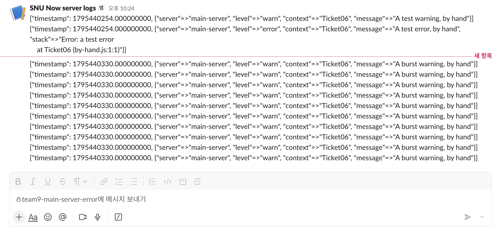

# 06: The pipeline runs once locally against the real webhook

Parent: [A02 spec](../spec.md)
Status: done
Blocked by: 03, 05

Native files: none. Releases: none.

**The webhook URL is a secret.** It never goes into chat, a pull request, an issue, a commit, a document, a configuration file, a test or a screenshot. A person reads it with `read -rs` and keeps it only in their password manager.

## What to do

On ticket 03's branch, run the pipeline with its real Slack output, as ticket 03's note beside the test describes. Pass the webhook as an environment variable read with `read -rs` (`docker run --env SLACK_WEBHOOK_MAIN_SERVER` with no value on the command line), then append:

- one info, one warn and one error line in the main server's JSON shape;
- a line that is not JSON;
- a burst of 30 identical warnings.

## Done when

- [x] The warn and error lines are posted to `#team9-main-server-error`; the info line and the line that is not JSON are not.
- [x] The burst gives 10 records (one post of 10 lines, see Comments).
- [x] The posts' text (Fluent Bit's printed record) is readable enough for the team. If it is not, say why under Comments before ticket 09 applies; formatting beyond what the Slack output prints is out of the spec's scope.
- [x] A screenshot of the posts, which shows no URL, is under Comments.

## Comments

- Done on 2026-11-23 by TaeHyun79, from PR B's 83b9efa4 with the steps of the pipeline test's `README.md` (`fluent-bit/test/`, now `fluent-bit-pipeline/test/`); the webhook went in through `read -rs` and `docker run --env` with no value.
- The warn and the error came as one post; the info line and the line that is not JSON were not posted. The burst of 30 gave one post of exactly 10 lines: Fluent Bit's Slack output posts once per flush, with a line per record. The criterion's "10 posts" was written before this was known and now reads "10 records".
- The posts read well enough: `"server"=>"main-server", "level"=>…, "context"=>…, "message"=>…`, and a stack keeps its line breaks in Slack.
- The container and the variable were removed afterwards.

### Agent usage (2026-11-23)

- No agent worked on this ticket by itself: the orchestrator's guidance and checks (commands, reading the results, `kubectl get` and `kubectl logs` after the owner signed in) are counted in the spec's table.
