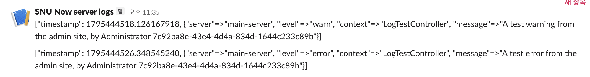

# 10: Warnings and errors from Production reach #team9-main-server-error

Parent: [A02 spec](../spec.md)
Status: done
Blocked by: 08, 09

Native files: none. Releases: none.

**The webhook URL is a secret.** It never goes into chat, a pull request, an issue, a commit, a document, a configuration file, a test or a screenshot. A person reads it with `read -rs` and keeps it only in their password manager.

## What to do

1. `kubectl --namespace logging get pods`
2. `kubectl --namespace snunow get pods`
3. On the Production admin site's Log test page, press info, then warn, then error.

## Done when

- [x] Two Fluent Bit pods are Running in `logging`, one on each node.
- [x] No pod in `snunow` is Pending.
- [x] The warn and error presses each give one post in `#team9-main-server-error`, naming `main-server` and the Administrator's ID; the info press gives none.
- [x] A screenshot of the posts, which shows no URL, is under Comments, and the spec's Status becomes done.

## Comments

- Done on 2026-11-23 (23:35 KST).
- `logging`: `fluent-bit-7n6cw` and `fluent-bit-hk8vx` Running, one on each node, no restart. `snunow`: every pod Running, none Pending.
- On the Production Log test page TaeHyun79 pressed info, warn and error, about ten seconds apart. The main server logged the three lines (the warn on one pod, the error on the other). Each node's Fluent Bit posted its own: `hooks.slack.com:443, HTTP status=200` at 14:35:18 and 14:35:26 UTC. The channel shows the warning and the error, each naming `main-server`, `LogTestController` and the Administrator's ID; the info line is not there.

### Agent usage (2026-11-23)

- No agent worked on this ticket by itself: the orchestrator's guidance and checks (commands, reading the results, `kubectl get` and `kubectl logs` after the owner signed in) are counted in the spec's table.
