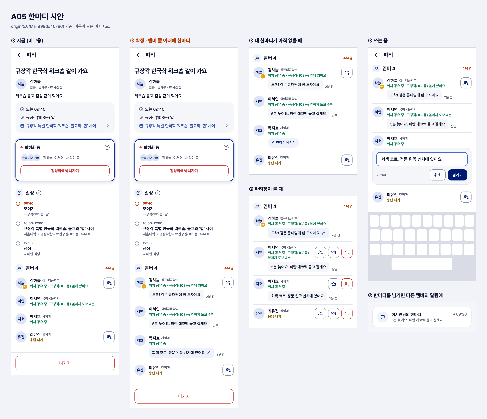

# 02: The 파티's room shows each member's 한마디 under their row, and the User writes their own there

Parent: [A05 spec](../spec.md)
Status: needs-triage
Owner: TaeHyun79
Blocked by: 01.

Native files: none. Database: none. Releases: an app OTA update, after 01's main server Release.

One pull request with 01 and 03, a commit for each ticket.

## What happens now

Positions are as of `origin/5.0/Main` 99dd46786.

- `멤버 {n}` draws a row for each Holder (`mobile/src/screens/room/people-sections.tsx:228`, `MemberRow` `:164`, `PersonRow` in `person-row.tsx:30`): the face, the name and department, a line with the lateness, the sharing state and the walk, and up to three buttons of 40 for the Leader. A line parts a row from the next.
- The section is left out for a Quest taken alone (`room-screen.tsx:194`). The footer gives way to the keyboard (`:232`).
- The rows come from the Quest's Holders and its `members` (`mobile/src/features/quests/room-adapter.ts`, `membersOf` `:197`, `lateOf` `:192`). `agoWords` (`:270`) words a time as "방금", "10분 전", "3시간 전" or "2일 전".
- `quests-changed` fetches the Quests and the open room's Quest again (`mobile/src/live/live-updates.tsx:54`).
- The room's inline form is a grey box with 취소 and 추가 (`plan-form.tsx:128`). It closes once the server took it and stays after a failure. `run` (`use-room-actions.ts:130`) says why in the refusals' words and fetches the room again.
- `TextEntry` (`mobile/src/design-system/text-entry.tsx`) is the one typed field. Its `most` limits the length by characters as Unicode numbers them, and its owner takes the words as they are given, or Hangul stops composing.
- A wording of time is worked out when the room's data changes, so it stands still on an open room. `useNow` (`mobile/src/hooks/use-now.ts:11`) is the app's ticking time.

## What to build

- **Reading.** A member with a 한마디 has a bubble under their row, from the words' start (52 from the left), with its time after it. The line that parts two members goes under the bubble. With a bubble, the pill or the form under it, the row has 10 above it and 6 below in place of its height of 64, and keeps its face, words and buttons.
  - The bubble: padding 8 by 12, corners 4, 12, 12 and 12, the words 14 over 20 in medium, wrapping and never cut. Another member's is on `surfaceSubtle`. The time is 12 over 16 in the muted ink, level with the bubble's foot.
  - A member without one looks as today, and the members keep their order.
  - The time is worded by `agoWords`, anew each minute while the room is open.
- **The User's own.** On blue 50 with a pencil at its end, a button of at least 36 high, "내 한마디 고치기" to a screen reader. Without one, the pill "한마디 남기기": 36 high, blue 50, semibold 13 in navy, with a pencil.
- **Writing.** Pressing either swaps it for a form on the step form's grey box: the field, named "한마디" for a screen reader, with no label above it and the example "예: 회색 코트, 정문 왼쪽이에요"; under it the count, "20/40", on the left, and 취소 and 남기기 on the right.
  - It opens with the User's words in it and takes the focus, one line and at most 40 characters.
  - 취소 closes it and keeps what was saved. 남기기 sends what is in the field, the empty text too, which clears it, and waits only while a save runs.
  - Saved: it closes without a toast, and the room is fetched again. Failed: the toast says why in the refusals' words, and the form stays with what was typed.
  - What is typed lives in the section, so a refetch does not touch it.
- **The app's API.** `QuestMember` gains `holderNote`, optional: missing, as from a main server before 01, or null is none. One operation writes it, in the client, the server's client and the mock.
- **The app's README**: the room's `멤버`.

## Must not break

- The rows' order, the lateness, the sharing state, the walk, a press on a seen member, 친구 추가, 파티장 넘기기 and 내보내기 with their dialogs.
- The screen of a Quest taken alone, and the room of a 파티 whose main server sends no `holderNote`.
- The keyboard: the form stands above it and the footer gives way, as for the step form.
- The crash reports and the usage records: no event and no breadcrumb carries the words.
- Tests: `room-*`, `main-room` (`.integration`), `room-adapter*`, `api/answers-quests` (`.unit`).

## Acceptance criteria

- [ ] Another member's 한마디 shows under their row with its time, a member without one has none, the order is as before, and nothing shows on a Quest taken alone. (App integration test, which fails before the change.)
- [ ] The time reads "방금" and then "1분 전" on a room left open. (Same.)
- [ ] The pill opens the form; the count follows the typing; 남기기 sends the words and closes it without a toast; 취소 sends nothing; the pencil opens it with the words; saving it empty sends the empty text. (Same.)
- [ ] A failed save shows the toast and keeps the form and its words. (Same.)
- [ ] A `quests-changed` while the form is open shows another's new 한마디 and keeps what is typed. (Same.)
- [ ] A reply without `holderNote` opens the room as before. (Same.)
- [ ] The room on the emulator looks as ② to ⑤ of the mock-up, and the pull request carries before and after pictures. No native file changes; lint, format and types pass.

## Comments
