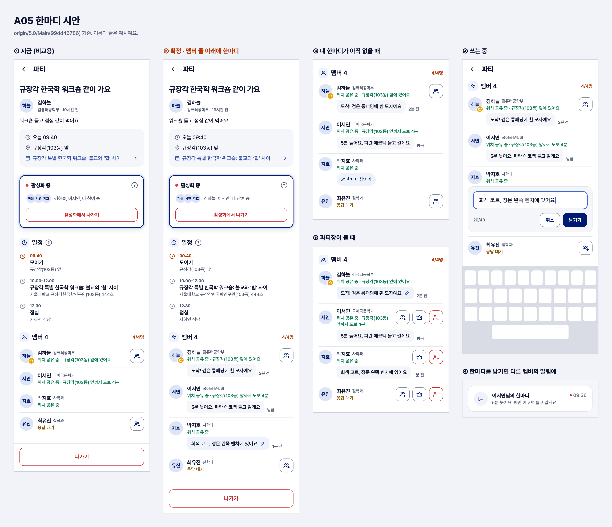

# A05: A Holder leaves one sentence for the 파티's other members (한마디)

Status: needs-triage

Owner: TaeHyun79. Target: released before the alpha (2026-11-30), so by the evening of 11-29. If that is missed, before the beta, by 12-04.

Every fact below was checked against `origin/5.0/Main` `99dd46786` on 2026-11-29.

## Problem Statement

A 공개 파티 (an Open or Approval Quest) brings strangers together. Until they meet, they know each other's name and department only. The room lost its chat in P15 ticket 61, and P15 ticket 62 put notices in its place: a step changed, a member arrived, a member is late. It says what that leaves open: "The last few metres in a crowd are not solved without words; that limit is accepted."

So two members who stand twenty metres apart in front of 규장각 cannot find each other. Nobody can say "회색 코트, 정문 왼쪽이에요", "5분 늦어요" or "저 못 찾겠어요", and a 파티 that cannot find itself at the meeting does not happen. The map helps only between members who activated the 파티 and share, and a dot does not say which of thirty people it is.

Bringing the chat back would be too much. What is missing is one sentence per member, as a KakaoTalk status is.

## Solution

Each Holder of a 파티 can leave **one sentence**, a Holder Note, which the screens call **한마디**: whether they are on their way, how late they are, where they stand, what they wear. It stands under their own row of 멤버 in the 파티's room, with how long ago it was written. Only the 파티's members see it. Writing a new one replaces the old one, clearing it deletes it, and the other members are told by a push and in 알림.

② is what was decided. ① is the room as it is now, for comparison. The canvas is <https://claude.ai/artifact/AtqY3dGB6D1M5DC6YRtpxb>.

The decisions, as made on 2026-11-29:

| Item | Decision |
| --- | --- |
| Where | Every 파티 that has a 멤버 section, 공개 or 비공개. Not a Quest taken alone (혼자 하는 퀘스트) |
| When | Any time, whether the 파티 is activated or not |
| Who sees it | The 파티's members (Holders) only. Not the 모집글, 찾기, the invited, or those who asked to join |
| Writing | 40 characters, one line, in place under the row. Saving it empty deletes it |
| How long it stays | Until its writer changes or clears it. Leaving the 파티 or being removed deletes it |
| Look | Mock-up ②. The members keep their order, and the time reads "2분 전" |
| Abuse | No filter and no report: names are real, and the Leader can remove a member (내보내기) |

## User Stories

Reading

1. As a member of a 파티, I want to read each member's 한마디 under their row in the room, so that I know who is coming, how late they are and how to recognise them.
2. As a member of a 공개 파티 whose people I have never met, I want to read what they wear or where they stand, so that I find them in a crowd.
3. As a member, I want to see how long ago a 한마디 was written ("방금", "2분 전", "3시간 전", "2일 전"), so that I do not take an old one for now.
4. As a member who keeps the room open while waiting, I want that time to move on, so that "방금" does not stay for ten minutes.
5. As a member with the room open, I want another member's new, changed or cleared 한마디 to show at once, so that I need not leave the room and come back.
6. As a member, I want the whole sentence shown, on two lines when it is long, so that nothing of it is cut.
7. As a member, I want the members to keep their order, so that I find the same person at the same place.
8. As a member, I want a member without a 한마디 to look as they do today, so that the section stays short.
9. As a member, I want a member's location state, lateness and walking time to stay on their row above the 한마디, so that the 한마디 adds to them and replaces nothing.
10. As a Leader, I want 친구 추가, 파티장 넘기기 and 내보내기 to stay where they are, so that the 한마디 under the row does not move them.
11. As a member of a 비공개 파티, I want the 한마디 there too, so that my friends and I need not go to another app for "5분 늦어".
12. As a member of a 파티 that nobody activated, I want to read and write a 한마디, so that it does not depend on sharing a location.
13. As a User relying on a screen reader, I want each 한마디 read with its time, so that I get what the others see.

Writing

14. As a member without a 한마디, I want "한마디 남기기" under my own row, so that I know I can leave one and where it will show.
15. As a member, I want to write it in place, in a field under my row, so that I still see the others' while I write.
16. As a member, I want the example "예: 회색 코트, 정문 왼쪽이에요" in the empty field, so that I know what to write.
17. As a member, I want a count such as "20/40", so that I know how much room is left.
18. As a member, I want the field to stand above the keyboard, so that I see what I type.
19. As a member, I want 취소 to close the field and keep what was saved, so that opening it costs nothing.
20. As a member, I want 남기기 to save it and close the field without a toast, so that the sentence under my row is the confirmation.
21. As a member whose save fails, I want a toast that says why and my words still in the field, so that I can try again without writing them anew.
22. As a member, I want my own 한마디 to carry a pencil and open the field with its words in it, so that I can change it.
23. As a member, I want to empty the field and save, so that my 한마디 is gone.
24. As a member who saves the same words again, I want nothing to happen: no push to the others and no new time.
25. As a member, I want to change it as often as I need, so that I can say "거의 다 왔어요" after "5분 늦어요".
26. As a member who pastes text with line breaks, I want it kept as one line, so that the room stays a list of single sentences.
27. As a member, I want my 한마디 to stay until I change or clear it, so that it does not vanish before the others read it.
28. As a member who is in several 파티, I want one 한마디 in each, so that what I tell one group is not told to another.
29. As a member who was writing when the room was refreshed by someone else's change, I want my unsaved words kept.

Being told

30. As a member, I want a push when another member leaves or changes a 한마디, so that I read "5분 늦어요" without opening the app.
31. As a member, I want the push and its row in 알림 to name who wrote it and show the words, so that I need not open anything to read them.
32. As a member, I want a press on either to open the 파티's room.
33. As a member, I want a person's new 한마디 in the same 파티 to replace the one before in 알림, so that it does not pile up.
34. As a member, I want nothing to ring when a 한마디 is cleared, and its row to leave 알림.
35. As the writer, I want no push and no row for my own.
36. As a member, I want to delete its row in 알림 with a swipe or 모두 지우기, as any other.

Privacy

37. As a member, I want nobody outside the 파티 to read it: not in the 모집글, 찾기 or an invitation, and not by asking the server.
38. As a member who leaves or is removed, I want my 한마디 gone from the room.
39. As a member who leaves and joins again, I want to start without one.
40. As a User, I want what I wrote kept out of the servers' logs, the crash reports and the usage records, as the app promises for what I type.
41. As a User, I want it never given to the AI.
42. As a Leader, I want to remove a member who writes something abusive, with the 내보내기 that is there today.

Not breaking what is there

43. As a User of an app older than this change, I want the 파티 and 알림 to work as before, with a 한마디's notice shown as an ordinary one.
44. As a User of the new app against a server older than this change, I want the room to open as before.
45. As a User with a Quest taken alone, I want its screen unchanged.

## Implementation Decisions

### What is stored

- A Holder's row gains two nullable columns, the words (`note`) and when they were written (`noted_at`): both set or both empty, and the words 1 to 40 characters long, which the migration checks. One migration, with no backfill and no default. The precedent on the same table is the late minutes of 2026-11-14.
- It must be stored: the other members read it later, on other phones. Redis with an expiry was weighed and dropped, since Production's Redis keeps nothing over a restart and every read of a Quest would need a second read.
- Nothing has to be cleaned up. A Holder who leaves, is removed or goes with the Quest loses the row, and the words with it. A meal Plan made again sets aside only a Quest held alone, and changing a Plan keeps the Quest, so neither drops a 파티's 한마디.

### The server's interface

- `PUT /quests/:questId/note` writes, replaces or clears the caller's own. Its body carries the words under the name `holderNote`, the empty text to clear. It answers 204, as handing the Quest over does.
- The words are trimmed, and a line break or a run of spaces becomes one space, before they are counted: at most 40 (UTF-16 units, as the app's field counts them, so an emoji counts as two or more). More is refused with 400.
- Only a Holder may call it. Anyone else gets `404 QUEST_NOT_FOUND`; a Class Quest is refused with `409 CLASS_QUEST` and a Quest taken alone with `409 QUEST_TAKEN_ALONE`, as they are today. Neither the Quest's end nor its activation is asked.
- The write runs under the Quest's lock, as every Holder's change does, so one that meets a removal runs before or after it. Saving the words that are stored changes nothing: not the time, no signal, no notice. It is safe to repeat, so it takes no Idempotency-Key. Nothing limits how often it is called.
- After a change every Holder gets the signal `quests-changed`, which already refetches the open room.
- A member in a Quest's reply gains `holderNote`: the words and their time, or null. It is null for the invited and the declined. Only the replies to a Quest's Holders carry members (checked: they are built in two places, both of which read by the Holder), so 찾기, an invitation and a request to join need no change.

### Kept out of the logs, the reports and the AI

- A request line keeps up to 2 KB of what was sent and answered, so leaving out this one route is not enough: the list of Quests, a Quest and 알림 all answer the words.
- `holderNote` joins the field names whose value the log masks. The request and the replies use that one name, so one entry covers both, at any depth.
- The notice carries the words in fields other Notifications share, which no name can mask. So `/notifications` joins the routes whose request line has no body.
- The main server's README says both, in its Logging section.
- No usage event is added for it, and no error's message is built from the words. The Assistant reads no member's `holderNote` and no Notification today, and gets neither.

### The room

- Under a member's row, at the row's full width from the words' start: the bubble, then its time. The line that parts two members goes under the bubble. The row keeps its face, its words and its buttons, the Leader's three among them, with 10 above it and 6 below in place of its height of 64.
- From the mock-up: the bubble starts 52 from the left (the face's 40 and its gap of 12), padding 8 by 12, corners 4, 12, 12 and 12, the words 14 over 20 in medium, wrapping and never cut. Another member's is on the subtle surface. The User's own is on blue 50 with a pencil at its end and is a button of at least 36 high. The time is 12 over 16 in the muted ink, after the bubble and level with its foot.
- The User without one gets the pill "한마디 남기기" there, 36 high, blue 50, semibold 13 in navy with a pencil.
- Pressing either swaps it for the form, on the grey box the room's step form uses: the field, whose example is "예: 회색 코트, 정문 왼쪽이에요", and under it the count "20/40" on the left and 취소 and 남기기 on the right. The field has no label above it and is named "한마디" for a screen reader. It takes the focus, at most 40 characters and no line break. 남기기 waits only while a save runs.
- Saved: the form closes without a toast and the room is fetched again. Failed: the toast says why, with the words the room's other refusals use, and the form stays with what was typed.
- What is typed lives in the section, so a refetch does not touch it.
- The time words are the ones the room uses already ("방금", "10분 전", "3시간 전", "2일 전"), worded anew each minute while the room is open.
- The app reads `holderNote` as optional: one that is missing is none.

### The notice

- A new kind, `holder-note`, kept for each other Holder, on the 파티's card and about its writer. So one replaces the one before by the same person in the same 파티, and rings and is unread again.
- Title: `이서연님의 한마디`. Line, and the push's body: the words alone, `5분 늦어요. 파란 에코백 들고 갈게요`, with no full stop added and without the 파티's title. (Decided on 2026-11-29 in place of "파티's title · words": a row of 알림 shows one line, and a long title would cut the words off whole.)
- It rings and opens the room, as the other news of a 파티 does. In 알림 it has the chat icon and the navy tone.
- Clearing cancels it for the other Holders and rings nothing.
- The notices are kept or cancelled before the reply, so that a save and a clear from one phone keep their order. A failure is logged as a warning and never fails the save.
- **A notice already delivered stays when its writer leaves or is removed, or the 파티 ends**, as a late report's and a changed step's do. (Decided on 2026-11-29.) It goes with a swipe, 모두 지우기 or the 30 days all notices are kept.
- Adding a kind needs no migration. An app that does not know it shows it as an ordinary notice, and a server that does not know it leaves it out of the list.

### How it is built

Three tickets, in one pull request with a commit for each:

1. **The server keeps it**: the migration, the route, the field in the replies, the mask in the log.
2. **The room shows and writes it**: the row, the form, the live refresh, the app's API with its mock.
3. **The others are told**: the kind, the push, the row in 알림, and `/notifications` without bodies in the log.

Native files: none. No new dependency. Documents: the main server's README (Quests, Notifications, Logging) and the app's README where it describes the room and 알림.

## Testing Decisions

A test says what a User or a client sees: what a request answers, what the room shows, what 알림 lists. None looks into a service, a component's state or a table. Names and levels follow ADR 0007. No new seam is added; the two that exist are enough.

**The main server's HTTP integration tests** (the started server on its database):

- write, read by another Holder in the list and in the Quest, replace, clear with the empty text;
- the same words again: the time stays, no signal, no notice;
- trimming, line breaks made spaces, 40 taken and 41 refused;
- refused: not a Holder, an invited User, a Class Quest, a Quest taken alone;
- gone after leaving, after being removed and after joining again;
- absent from 찾기, an invitation and a request to join;
- `quests-changed` to every Holder;
- the notice: to the others and not to the writer, its title, line and address, replaced and unread again on a new one, gone on clearing, still there after the writer left.
- Prior art: the late report's test, the members' notices', the Quest's members', a notice's room address.

**The app's room and 알림 integration tests** (the app's router over the fake main server):

- another's 한마디 with its time, none for a member without one, the order unchanged, nothing on a Quest taken alone;
- the pill, the form, the count, 취소, 남기기 and what it sends, the pencil with the words in the field, clearing;
- a failed save: the toast, the form and its words stay;
- a signal shows a new one while the form is open and keeps what is typed;
- the row in 알림, its icon and that a press opens the room;
- a reply without `holderNote` opens the room as before.
- Prior art: the room's member row, people and keyboard tests, 알림's kept and room tests.

**The log**: no new test file. The masked name is added to the log body's test, and `/notifications` to the test of the routes without bodies and to the one that sends a request and looks for the value in the lines.

Existing tests that compare a member exactly gain `holderNote: null`. Only the changed files' tests are run by hand; CI runs the rest. The pull request carries before and after pictures of the room and 알림 from the emulator.

## Out of Scope

- Moving the map's pin, the way and the arrival notice of an event's 파티 to its 모이기 step.
- The privacy policy (처리방침): unchanged, so nobody is asked to consent again.
- A filter, a report or a block. The 모집글 and the steps are free text without one today.
- The 한마디 on the map's card, on the 파티 list's cards or anywhere but the room and 알림.
- Giving it to the AI, or letting the AI write it.
- Replies, reactions, read marks, a history, a list of examples to tap, a 지우기 button.
- Hiding it when the 파티 is over. A step the 파티 form makes has a start and no end, so such a 파티 never counts as over; the time beside the words ("2일 전") says how old they are.
- The Schedule sheet's row, which the owner adds.

## Further Notes

### The migration's limits, and the Release

- **After the Release, no earlier Release can be deployed again.** Migrations only move forward (`infra/production/README.md`: "Never deploy again across a migration"), so a fault is fixed forward. Because of that, releasing by the evening of 11-29 is the safe choice: the night before the alpha has no way back.
- **The main server first, then the app.** One `all` Release does both in that order. Both directions are safe meanwhile: the old app ignores the new field, and the new app takes a reply without it. While the pods are replaced, the old one works on the new schema, since both columns are nullable.
- A migration that stops halfway keeps the new pods from starting while the old ones go on serving, and is resolved by hand (the same README, "A migration left halfway"). Two nullable columns on a small table make that unlikely.
- After merging, each developer runs the migration locally and generates the Prisma Client again. The Dev Server applies it when it deploys.
- Dropping the feature later means another migration, or leaving the two empty columns.

### The schedule

- Asked of the team: accept or refuse on the morning of 11-29. Accepting sets this spec and its tickets to `ready-for-agent`, and they are implemented at once, in an estimated one to two hours. CI takes 10 to 13 minutes on `5.0/Main` and a Release 8 to 9 in the last runs, the reviews not counted.
- Missed on 11-29, it is released before the beta, by 12-04. No earlier date drops it.

### Other work it meets

- No open pull request touches the room, the Quest's replies, the log's rules or the schema.
- 알림 is being changed by [#800](https://github.com/snuhcs-course/swpp-2026-project-team-09/pull/800) (오늘), [#802](https://github.com/snuhcs-course/swpp-2026-project-team-09/pull/802) on top of it and [#785](https://github.com/snuhcs-course/swpp-2026-project-team-09/pull/785). None of them edits the kinds' icons or tones, which is all ticket 03 adds in the app, but they change tests of 알림 it may extend. 03 waits for none of them: whoever merges second merges `5.0/Main`.
- P15-62 (a late report and the members' notices, [#374](https://github.com/snuhcs-course/swpp-2026-project-team-09/pull/374)) is the closest earlier work in shape and size: 20 files, +695/−36, server, app and tests in one pull request. This one is a little larger.

### What this changes in an earlier decision

P15 ticket 62 accepted that the last few metres are not solved without words. This spec solves them with one sentence a member, and brings back no chat.
